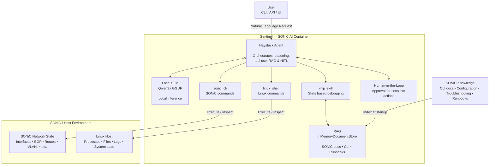

# Sentinel
SONiC Embedded Network Intelligence & Tooling Engine


## Abstract
This work presents **Sentinel**, an agentic, on-device AI framework for SONiC (Software for Open Networking in the Cloud) that integrates a Small Language Model (SLM) directly into the network operating system environment. Sentinel combines a locally hosted SLM with Haystack-based agent orchestration, Retrieval-Augmented Generation (RAG), and Human-in-the-Loop (HITL) capabilities to enable intelligent network troubleshooting and operational assistance without relying on external AI services. SONiC-specific knowledge, including CLI documentation, configuration guidance, and troubleshooting procedures, is indexed using an in-memory document store and retrieved dynamically by the agent. Sentinel is equipped with SONiC and Linux execution tools, enabling it to inspect network state, reason over observed information, and perform operational tasks, while HITL mechanisms provide controlled intervention for sensitive actions. The complete framework is packaged as a self-contained SONiC container, enabling local and offline deployment. Sentinel provides a lightweight and extensible foundation for context-aware and increasingly autonomous network operations.


## Flow Diagram


## Architecture

```text
User
  │
  ▼
Haystack Agent
  │
  ├──── Local SLM ────► Reasoning / Tool Selection
  │
  ├──── RAG ──────────► SONiC-specific knowledge
  │
  ├──── sonic_cli() ──► SONiC operations
  │
  ├──── linux_shell() ► Linux operations
  │
  └──── HITL ─────────► Human approval when required
```

## Ship

The GGUF must be in `models/` on the build machine (gitignored). Copy the local llama CLI and the project venv into the image context (also gitignored). Build for the switch architecture (`linux/amd64`).

```bash
cp "$(command -v llama)" docker/llama
rm -rf docker/venv && mkdir -p docker/venv
cp -a .venv/. docker/venv/
docker build --platform linux/amd64 -t docker-sentinel:latest .
docker save docker-sentinel:latest | gzip > docker-sentinel.gz
```

On the switch:

```bash
sudo docker load -i ./docker-sentinel.gz
sudo docker run --rm -it --name sentinel \
  --network host --pid host --privileged \
  docker-sentinel:latest
```

## Testing changes locally

Install llama.cpp:
```bash
irm https://llama.app/install.ps1 | iex
```

In one terminal run the llama-serve:
```bash
llama serve -m models/Qwen3-4B-Instruct-2507-Q5_K_M.gguf -a Qwen3-4B-Instruct-2507 --host 127.0.0.1 --port 8888 --jinja --reasoning off -c 8192 -n 1024 -np 1 
```

```bash
uv sync
source .venv/bin/activate
uv run sentinel
```
